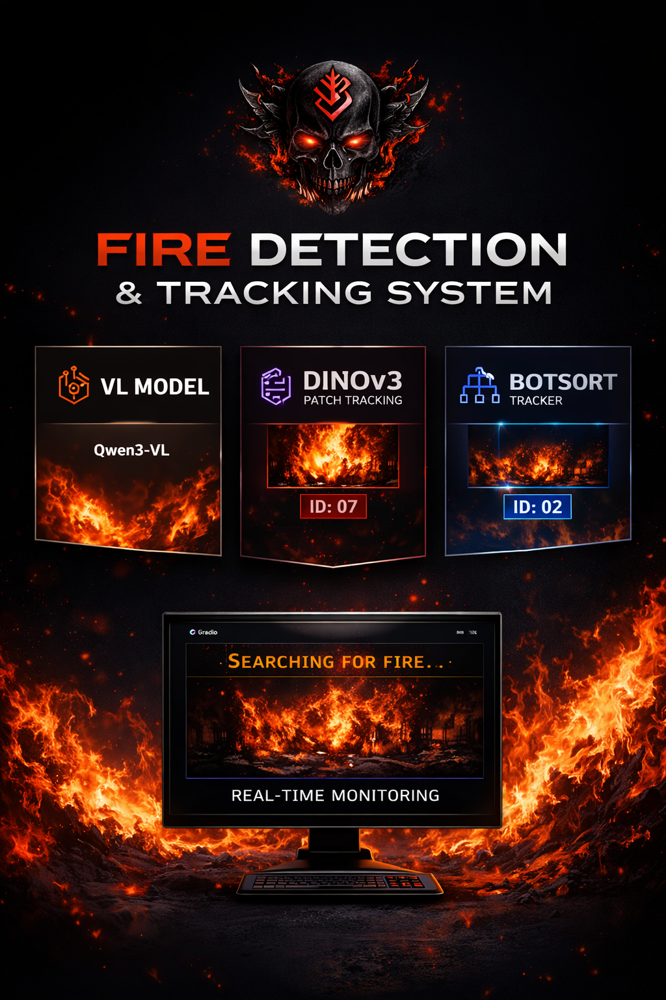
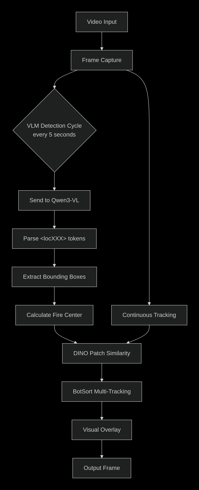
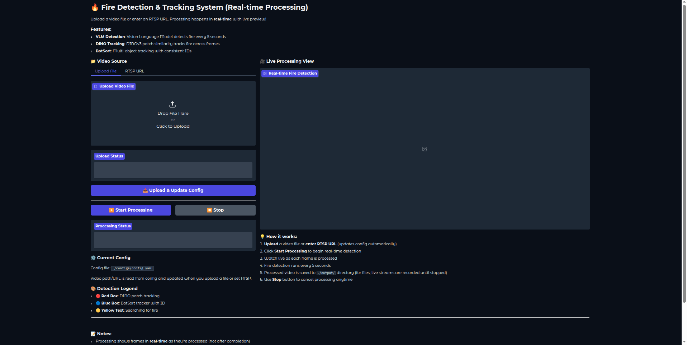

# 🔥 Fire Detection & Tracking System

## Overview
A real-time fire detection and tracking system that combines Vision Language Model (VLM) for detection with DINOv3 patch similarity and BotSort for tracking. The system processes video streams in real-time with a Gradio web interface.

## 🚀 Features

- **Multi-Model Detection**: Uses fine-tuned Qwen3-VL model for fire detection
- **Intelligent Tracking**: Combines DINOv3 patch similarity with BotSort multi-object tracking
- **Real-time Processing**: Live frame-by-frame processing with visual feedback
- **Multiple Input Sources**: Supports video files and RTSP streams
- **Web Interface**: User-friendly Gradio interface for easy interaction
- **Dockerized**: Easy deployment with GPU support

## 🏗️ Architecture

The system consists of three main components:

1. **VLM Detection Server**: Llama.cpp server running fine-tuned Qwen3-VL model
2. **Tracking Engine**: DINOv3 + BotSort for consistent fire tracking
3. **Web Interface**: Gradio-based UI for real-time monitoring

## ⚙️ Technical Architecture - Detection Pipeline




## 📋 Prerequisites

- NVIDIA GPU with CUDA support
- Docker & Docker Compose
- At least 8GB GPU memory
- 16GB+ system RAM

## 🛠️ Installation

### 1. Clone Repository
```bash
git clone https://github.com/lampurights-coder/vlm_fire_tracking.git
cd vlm_fire_tracking
```

### 2. Prepare Model Weights
Place your model files in the `weights/` directory:
- `larshiakzemil_unsloth_finetune_qwen3-vl-8b-instruct.Q8_0.gguf`
- `larshiakzemil_unsloth_finetune_qwen3-vl-8b-thinking.BF16-mmproj.gguf`

### 3. Build Docker Image
```bash
docker build -t fire-detection-system .
```

## 🚀 Usage

### Start the System
```bash
docker run --rm -it --gpus all -p 8033:8033 -p 9007:9007 fire-detection-system
```

### Access the Interfaces
1. **Gradio Web Interface**: `http://localhost:9007`
2. **VLM API Server**: `http://localhost:8033`

## 🌐 Web Interface Guide

### 1. Upload Video
- Navigate to the "Upload File" tab
- Select a video file (MP4, AVI, MOV)
- Click "Upload & Update Config"

### 2. Use RTSP Stream
- Navigate to the "RTSP URL" tab
- Enter RTSP URL (e.g., `rtsp://camera-ip/stream`)
- Click "Set RTSP URL"

### 3. Start Processing
- Click "Start Processing" button
- Watch real-time detection in the video window
- Processing status updates live

### 4. Stop Processing
- Click "Stop" button anytime to halt processing

## 📊 Detection Legend

- **Red Box**: DINO patch similarity tracking
- **Blue Box**: BotSort tracker with object ID
- **Yellow Text**: System is searching for fire
- **Green Box**: VLM detection results

## 🔧 Configuration

### Config File Location
`./configs/config.yaml`

### Key Parameters
```yaml
sources:
  - id: 11
    url: /path/to/video.mp4  # Video source
    fps: 30                  # Frame rate
```

### VLM Settings
- Detection interval: 5 seconds
- Confidence threshold: 0.6
- Top-K patches: 10

## 📁 Project Structure

```
.
├── weights/                 # Model weights
├── configs/                 # Configuration files
├── output/                  # Processed videos
├── uploaded_videos/         # User uploaded videos
├── src/
│   ├── detector.py         # VLM detection module
│   ├── dino.py            # DINOv3 similarity module
│   └── frame_gather.py    # Frame synchronization
├── gradio_video.py         # Main Gradio application
├── requirements.txt        # Python dependencies
├── Dockerfile             # Docker configuration
├── start.sh              # Startup script
└── config.yaml           # Main configuration
```

## ⚙️ Technical Details

### Detection Pipeline
1. **VLM Detection**: Every 5 seconds, frame is sent to Qwen3-VL model
2. **Bounding Box Extraction**: Parse `<locXXX>` tokens from model output
3. **Center Calculation**: Find center of largest detected fire region
4. **DINO Tracking**: Use patch similarity to track fire across frames
5. **BotSort Tracking**: Multi-object tracking with ID consistency

### Models Used
- **Qwen3-VL-8B**: Fine-tuned for fire detection
- **DINOv3 ConvNeXt Tiny**: Patch similarity
- **BotSort**: Multi-object tracking

## 🐛 Troubleshooting

### Common Issues

1. **GPU Memory Error**:
   ```bash
   # Reduce batch size
   docker run --rm -it --gpus all -p 8033:8033 -p 9007:9007 \
     -e CUDA_VISIBLE_DEVICES=0 fire-detection-system
   ```

2. **VLM Server Not Starting**:
   ```bash
   # Check if ports are available
   netstat -tulpn | grep 8033
   ```

3. **No Detection Results**:
   - Check VLM server is running at `http://localhost:8033`
   - Verify model weights are correctly loaded
   - Adjust detection threshold in code

### Logs
Check Docker logs:
```bash
docker logs <container_id>
```

## 🔄 Updating Models

To update the VLM model:
1. Convert new model to GGUF format
2. Place in `weights/` directory
3. Update model name in `start.sh`
4. Rebuild Docker image

## 🤝 Contributing

1. Fork the repository
2. Create feature branch
3. Commit changes
4. Push to branch
5. Create Pull Request

## 📝 License

[Your License Here]

## 🙏 Acknowledgments

- [Llama.cpp](https://github.com/ggerganov/llama.cpp) for efficient inference
- [Qwen Team](https://github.com/QwenLM/Qwen) for Qwen3-VL model
- [Meta Research](https://github.com/facebookresearch/dinov2) for DINOv3
- [BoxMOT](https://github.com/mikel-brostrom/boxmot) for BotSort implementation

## 📞 Support

For issues and questions:
1. Check [Troubleshooting](#-troubleshooting) section
2. Open GitHub Issue
3. Contact: [larshiakazemil@gmail.com]

---

**Note**: This system is designed for research and demonstration purposes. Always verify fire detection with multiple systems in production environments.
